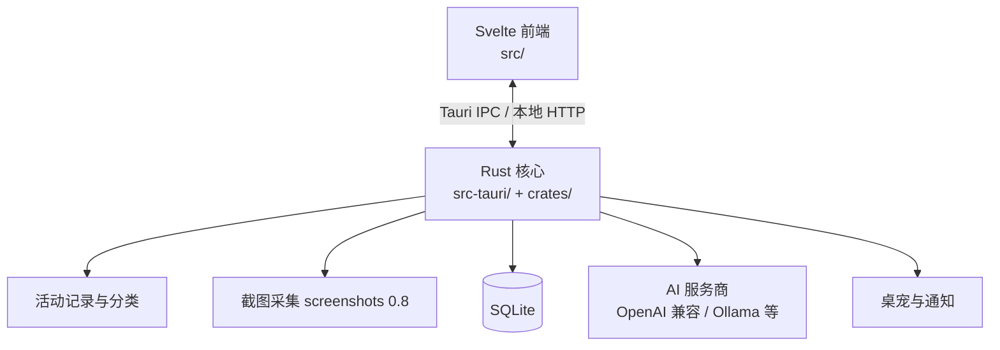
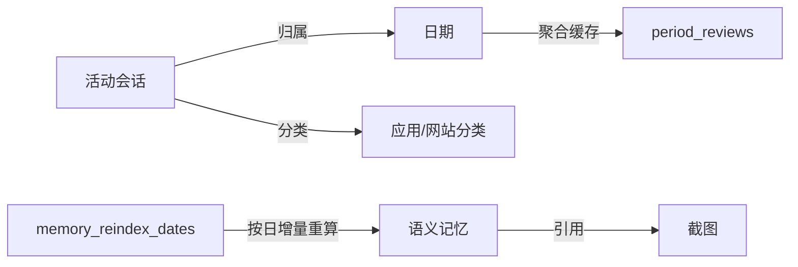

# PROJECTWIKI.md

> 基础版知识库（2026-08-18 创建）。当前以"骨架 + 已知信息"为原则建立，各章节标注待补全项，后续随代码变更增量更新，避免整篇重写。

## 1. 项目概述

- **目标**：Work-Review——自动记录电脑工作活动（应用/网站/截图），生成工作日报与统计，辅以 AI 助手、语义记忆与桌宠通知。
- **背景**：面向个人工作复盘与效率管理，支持 Windows / macOS / Linux。
- **范围**：活动记录与分类、AI 日报/助手、桌宠通知、多语言界面（简中/繁中/英/阿文）。
- **技术栈**：Tauri 2.10（Rust 核心）+ Svelte 5 / Vite 5 / Tailwind 前端 + TypeScript / Vitest 工具链（Node 22+），数据存 SQLite。
- **运行环境**：桌面端；macOS 需辅助功能/输入监控授权，Windows 涉及 UIA 探测与 Defender 智能控制说明。

## 2. 架构设计

- 关键路径：活动记录 → 分类（内置知识库 + AI 学习）→ 统计/日报 → AI 助手与记忆检索。
- 前端入口 `src/`，Rust 入口 `src-tauri/` 与 `crates/`（workspace），构建产物经 `dist/`。

## 3. 架构决策记录（ADR）

- 目录：`docs/adr/`（待建立；当前以本节条目形式记录）
- **ADR-20260818-01｜RustSec 审计降噪策略**：`cargo audit` 仅对**漏洞与 unsound 类**公告建 Issue 跟踪；unmaintained 类（gtk-rs GTK3、unic-\*、paste、proc-macro-error、fxhash、rustls-pemfile，共 19 条）加入 `security-audit.yml` 的 `ignore`。理由：unmaintained 为信息性提示、无 patched 版本、多数源于 Tauri 2 Linux 依赖树，无法通过升级消除。影响：审计 Issue 信噪比提升；待 Tauri 3 / GTK4 迁移时可重估。2026-08-20 追加：应作者要求移除每周定时触发（ADR-20260820-01），改为锁文件变更触发 + 手动运行。
- **ADR-20260818-02｜AI 服务商配置缓存**：`AppConfig` 新增 `text_model_provider_cache: HashMap<String, ModelConfig>`（key 为 provider id），前端 `SettingsAI` 切换服务商时把当前配置快照写入该缓存并随保存落盘，初始化时载入。理由：原实现仅组件内存缓存（`providerConfigs`），切标签页/重启即丢，且后端 `text_model` 单值字段保存新服务商时覆盖旧 Key。兼容性：`#[serde(default)]`，旧配置文件可正常加载。测试：`src/routes/settings/ProviderKeyMemory.test.ts`。
- **ADR-20260819-01｜思考型模型兼容**：DeepSeek V4/R1、Qwen3 等"对话+思考"混合模型的思维链走 `reasoning_content` 字段（与 `content` 同级）。此前应用完全不解析该字段，且助手链路 `max_tokens=1600` 会被思考耗尽导致"连接测试成功但助手无回复"（测试仅校验 HTTP 200）。决策：① 流式装配器与非流式解析均支持 `reasoning_content`（思考帧实时输出、空正文兜底思维链）；② OpenAI 兼容链路默认 `max_tokens` 8192（Claude 默认 1600，均可被 `max_output_tokens` 覆盖）；③ 连接测试校验非空输出（content 或 reasoning_content），探测额度 16→256。显式思考开关见 ADR-20260822-01。测试：`src/ReasoningModelCompat.test.ts` + `crates/core/src/generation_params.rs` 单测。
- **ADR-20260822-01｜助手超时与思考开关**：不合并 PR #142，在主干自实现。超时：`assistant_timeout_secs`（默认 120，30–900）作为一次助手请求的**单一绝对 deadline**，响应头、流式空闲、429 重试、确认等待、收束共用剩余预算；前端超时额外 +2s 并调用 `cancel_assistant_request`。收束从总预算预留 5–15 秒。日报：`report_generation_timeout_secs`（默认 300，60–1800）外层 `timeout` + `abort_handle`；内层 AI 预算 = 外层减 60 秒（下限 30 秒）。思考：设置页按 Provider 能力映射，未支持的提供商不发送扩展字段（Ollama `think`、Qwen 仅流式 `enable_thinking`、SiliconFlow `chat_template_kwargs`、Claude 无工具时 `thinking`、Gemini `thinkingBudget`）。Claude 带工具时不开启 thinking，避免多轮签名块丢失。代码：`crates/core/src/generation_params.rs`、`src-tauri/src/agent/deadline.rs`。
- **ADR-20260822-02｜WebDAV 常用配置同步**：截图 WebDAV 之外可选同步 `work-review/app-config.json`。最后写入获胜；本机 `localhost_api_*`、窗口坐标、自启、导出目录、`node_gateway` 不覆盖。SQLite 活动数据不同步。**2026-11-22 由 ADR-20261122-01 取代同步范围部分。**
- **ADR-20261122-01｜配置同步 v2：白名单 + 隐私只增不减**：原实现上传整份 `AppConfig`（含全部密钥），拉取时 `*self = remote` 整体覆盖，能写入 WebDAV 文件者即可改写模型端点、Telegram 白名单与隐私规则。决策：信封升级为 `format: 2`，只含 `SYNCED_PREFERENCE_FIELDS` 白名单字段（`crates/core/src/config.rs`）与隐私规则；新增字段默认不同步；隐私规则经 `merge_privacy_additive` 只增不减（按归一化应用名合并并拒绝空归一化通配规则）；读取 v1 时同样只取白名单并把远端改写为脱敏快照；`update_app_config_with_source(Sync)` / `persist_app_config_with_source(Sync)` 不重打时间戳、不回推，推送串行化且首次开启同步先拉取再推送。取舍：多设备删除隐私规则不再同步（只能在各设备分别删除）。兼容：旧客户端拒绝 v2 信封，不会被覆盖。测试：`config.rs`、`config_sync.rs`。
- **ADR-20261122-02｜对外输出脱敏策略**：凡离开本机或交给外部模型 / 客户端的活动数据（MCP、本地 API、助手工具结果、AI 日报上下文、小时汇总、时间线 JSON 导出），先剔除忽略应用 / 排除域名（统一走 `privacy::matches_ignored_app` 归一化匹配），再按**当前**规则经 `privacy::sanitize_activity_for_external` 处理脱敏应用与文本密钥；MCP 读取活动 / 会话 / 统计默认 `AllowSanitized`（配置热重载，`mcp_include_ocr` 才放行 OCR 原文），本地 API 返回 OCR 需同时满足本机配置 `localhost_api_include_ocr: true` 与请求 `?include_ocr=true`。界面内时间线保持原有展示不做追溯脱敏。截图层面在 Windows 上由 `screenshot_mask.rs` 对可见敏感窗口涂黑（Z 序遮挡计算，半透明 / 桌宠 / `WDA_EXCLUDEFROMCAPTURE` / 非矩形裁剪窗口不计遮挡，宁可多遮）。
- **ADR-20261122-03｜Bot 发送者授权**：飞书 / 钉钉 / 企业微信此前任何能给机器人发消息的人都能查询日报。决策：复用 Telegram 绑定码模式，`AppConfig.bot_sender_bindings`（key：feishu / dingtalk / wecom，不参与同步）+ `bot_common::check_bot_sender`；绑定码 10 分钟、错误 5 次作废、常量时间比较；`is_duplicate_bot_message` 按消息 ID 去重（512 条 / 10 分钟）。影响：升级后需重新绑定（CHANGELOG 已标注）。
- **ADR-20261124-01｜查询时项目归集与一键目录备份**：项目/标签工时归集采用查询时动态匹配（`crates/core/src/project.rs`），不新增数据库列，规则调整即时生效且不触发 FTS 写放大；正则预编译限制体积，隐私忽略规则优先于项目归集。一键备份采用纯目录格式（`VACUUM INTO` + `manifest.json` SHA-256 + `user_version` 版本门禁，零新增 zip 依赖），默认不含截图与密钥，恢复复用 `migration-stage` 原子替换并在覆盖前先自动备份现网数据。
- **ADR-20261124-02｜增量语义索引与按日失效重算**：新活动写入仅更新活动总数而不重置 `ready` / `build_id`，向量检索在指纹一致且存在已嵌入分块时即可工作；SQLite `user_version = 3` 新增 `memory_reindex_dates`，OCR 晚到或活动删除仅将受影响日期入队局部重算，追加写入从游标延续；可选后台自动索引 `semantic_auto_index` 默认关闭且不同步，避免静默外发 OCR 到嵌入服务。
- **ADR-20261124-03｜周期复盘持久化与 Bot 只读自然语言问答边界**：周报/月报复盘缓存至 SQLite `period_reviews(period_type, period_key, locale)` 并支持四语言输出，活动删除时自动失效相关周期缓存。Bot 自然语言问答（`bot_natural_language_enabled`，默认关闭、不同步）仅向已绑定发送者开放，构造严格只读的 `AssistantRuntime`（`actions = None`、`confirm = None`、`web_tools = None`、默认只读记忆能力）并对输出执行二次脱敏与按发送者限流（6 次/60 秒）及并发信号量限制；飞书/钉钉/Telegram 异步回推，企微 HTTP 回调以 3.5 秒超时兜底提示切至长连接模式。
- **ADR-20261124-04｜M4 工程化：Rust 主入口模块化、Bot 统一管线、Svelte 5 渐进迁移与行为测试体系**：① 将 6,731 行 `src-tauri/src/main.rs` 拆分为 `window.rs`、`tray.rs`、`bootstrap.rs`、`break_reminder.rs`、`crash.rs`、`recording/*`、`tasks/*` 14 个子模块，`generate_handler!` 收拢至 `commands::handler()`；② 飞书/钉钉/企微回调与长连接/Telegram 统一经 `bot_common::route_inbound_bot_message`、`shared_bot_http_client()` 与 `timestamp_within_window_{secs,ms}` 处理，`InboundBotMessage` 通过私有字段 + 受控构造器防止授权绕过；③ 在保留 Vite 5 与 0 生产审计漏洞前提下升级至 `svelte@5.59.1`、`@sveltejs/vite-plugin-svelte@4.0.4`、`svelte-spa-router@5.1.1`、`marked@18.3.0`，入口切至 `mount()` 并率先迁移 `Toast`/`ConfirmDialog`/`Sidebar`/`ModelRoutingPanel`/`BotSenderBindingPanel` 至 Svelte 5 runes；④ 引入 `vitest@3.2.7` + `@testing-library/svelte@5.4.2` + `jsdom@26.1.0` 与 `@tauri-apps/api/mocks`（`mockIPC`）建立真实 DOM 组件行为测试，并以基于 Svelte AST 与递归扫描的 `src/SecurityInvariants.test.ts` 锁定 CSP、`{@html}` DOMPurify、capabilities 与 `envPrefix` 安全不变量。

## 4. 设计决策 & 技术债务

- **screenshots 0.8.10 依赖链**：引入 rand 0.7.3（RUSTSEC-2026-0097）与 0194/0195 两条已知公告；Linux-only 路径不接触用户输入，上游暂无升级版本，待上游修复后 `cargo update`。
- **gtk-rs GTK3（0.18.x）**：Tauri 2 Linux/webkit2gtk 固有依赖，全部 unmaintained；待 Tauri 生态迁移 GTK4 后自然消除。
- **unsound 评估结论（#167-#171 已关闭）**：anyhow 1.0.102（无 `downcast_mut` 调用，仅 image/rav1e 错误传播）、event-listener 5.4.1（zbus 等传递依赖，不直接调用 tag API）、glib 0.18.5（gtk/tray-icon 传递依赖，不迭代 `VariantStrIter`）、memmap2 0.7.1（screenshots/libwayshot 传递依赖，不接受不可信 offset）、rand 0.7.3（仅构建依赖链 phf_generator，运行时不存在）——触发条件均不可达，2026-08-23 评估后全部关闭；后续 unsound/漏洞类公告仍按 Issue 跟踪。
- **`default-text-model` 档案覆盖行为**：`sync_text_model_profiles()` 每次保存仍会用当前 `text_model` 覆盖 `default-text-model` 档案（历史行为保留）。服务商 Key 保留已由 `text_model_provider_cache` 承担（ADR-20260818-02），档案系统若需累积历史配置需另行改造。
- **助手问题细分类已移除**：`AssistantQuestionKind` / `detect_assistant_question_kind` 在 Agent 路由落地后不再参与生产分类（入口只区分工作复盘 / 普通聊天）。2026-08-22 已删除该死路径及只测它的用例。
- **布局内容轴策略**（2026-08-22）：操作型页面（设置板面等 `page-axis-operation`）满宽铺开（`--content-width-operation: none`），与概览/时间线一致，宽度由卡片内部网格吸收；阅读型内容（AI 对话、日报正文 `page-axis-reading`）保留 `84rem` 行长上限保证可读性。超宽屏仍受 page-shell（`128rem`@≥1600px）/stage（`160rem`@≥1920px）收束。玻璃拟态（backdrop-blur）在 Linux（WebKitGTK）通过 `platform-linux` 类平台级降级为高不透明度实底。
- **浮层 portal 约定**（2026-08-23）：玻璃壳层（`.app-shell-*-frame`）与详情遮罩的 `backdrop-filter` 会把内部 `position: fixed` 的包含块从视口劫持为该祖先，视口坐标定位的浮层会错位/被裁。因此所有 fixed 浮层必须挂 `use:portalToBody`（`src/lib/actions/portal.ts`）移挂 `document.body`——已覆盖时间线详情遮罩、概览分类弹层、时段摘要抽屉、日报三个模态；时间线分类已改为行内标签，不再使用视口定位弹层。`absolute` 定位浮层（如日报导出菜单面板）不受影响无需处理。契约测试 `src/lib/actions/portal.test.ts` 守护。
- **时间线详情阅读顺序**（2026-08-25）：活动详情抽屉以截图为视觉中心，窗口标题/网址作图注，当前分类单独钉在标签最前，其余分类作备选，记录策略收入「对此应用」折叠区；避免分类管理面板盖住截图。
- **npm 侧**：`npm audit --omit=dev` 作为门禁（高危拦截）；构建工具链漏洞仅报告（当前 9 条，含 nanoid GHSA-2v37-7h3g-55p8）。
- **隐私加固遗留项**（2026-11-22，M1）：
  - 截图遮罩仅 Windows 实现；macOS（`CGWindowListCopyWindowInfo` 坐标换算需真机验证）与 Linux（无统一窗口枚举手段）仍按前台应用判断隐私。DirectComposition 透明浮层计为遮挡物（实测常规不透明窗口普遍使用该样式），其下方敏感窗口可能漏遮。
  - `mcp_include_ocr` / `localhost_api_include_ocr` 暂无设置页开关，需手动编辑 `config.json`。
  - Bot 群聊回复对全群可见；企业微信回调与智能机器人共用一份绑定名单（不同企业 userid 可能冲突）。
  - 配置写入：`update_app_config` 在同一把锁内读-改-写；旧的整份写入调用点（分类、托盘、日报缓存等）仍是"克隆-解锁-写回"，但统一保留锁内的 Bot 绑定，后续宜逐个迁移。
  - 前端 capability 已收敛，但 `main` / `avatar` 两窗口仍共用一个权限集，待逐项验证桌宠窗口所需权限后拆分。
  - 设置页各面板仍整份保存草稿配置（表单语义）；页面外的局部写入已改用 `patch_config` / `set_app_privacy_level`。
  - 密钥仍明文存于 `config.json`（既有决策，commit `7f1e5d9`）；便携模式下随 EXE 携带，是否引入 DPAPI / Keychain 待单独决策。
- **后续计划**（M2 性能与正确性、M3 新功能、M4 工程化）：维护者本地 `plan.md`（已在 `.gitignore` 中，不随仓库分发）；对外进度以 CHANGELOG 与 Issue 为准。

## 5. 模块文档

| 模块 | 职责 | 备注 |
|---|---|---|
| `src/` | Svelte 5 前端（界面、设置、助手、桌宠） | 布局内容轴与玻璃拟态 token 见 `src/app.css`；`Toast`/`ConfirmDialog`/`Sidebar`/`ModelRoutingPanel`/`BotSenderBindingPanel` 已迁移至 Svelte 5 runes；组件行为测试见 `src/test/components/*.vitest.ts`，安全不变量守卫见 `src/SecurityInvariants.test.ts` |
| `src-tauri/` | Tauri 主程序（Rust 核心、IPC、本地 API） | `main.rs` 仅留 ~790 行启动装配与状态定义；IPC 注册统一在 `commands/mod.rs::handler()`；窗口/托盘/启动监督/休息提醒/崩溃捕获拆至 `window.rs`、`tray.rs`、`bootstrap.rs`、`break_reminder.rs`、`crash.rs`；采集与后台循环拆至 `recording/{mod,merge,browser_url}.rs` 与 `tasks/{recording,avatar,hourly_summary,entity_classify,storage}.rs` |
| `crates/core/src/generation_params.rs` | 思考/token 预算按 Provider 协议映射 | 未支持的提供商不写扩展字段 |
| `src-tauri/src/wecom_bot.rs` | 企业微信自建应用 HTTP 回调（需公网） | 与长连接并存；解密按 32 字节块去 PKCS#7 填充 |
| `src-tauri/src/bot_common.rs` | 四个 Bot 统一入站管线（`route_inbound_bot_message`）、共享 HTTP client、时间戳防重放窗口、发送者授权、消息去重与只读自然语言问答 | 见 ADR-20261122-03、ADR-20261124-03、ADR-20261124-04 |
| `src-tauri/src/commands/project.rs` | 项目规则管理、7 天命中预览与单活动归属解析 IPC 命令 | 配合 `crates/core/src/project.rs` |
| `src-tauri/src/commands/backup.rs` | CSV/JSON 数据导出、带 SHA-256 清单的一键备份与原子恢复 | 见 ADR-20261124-01 |
| `src-tauri/src/commands/period_review.rs` | 周报/月报周期复盘读取、生成缓存与 Markdown 导出 | 见 ADR-20261124-03 |
| `src-tauri/src/screenshot_mask.rs` | 截图隐私遮罩：Z 序枚举可见窗口、计算未遮挡区域并涂黑敏感窗口 | 仅 Windows；几何为纯函数并有单测 |
| `src-tauri/src/navigation_guard.rs` | WebView 导航守卫插件：只允许停留在应用自身地址 | 与前端 `src/lib/actions/externalLinks.ts` 双层防护 |
| `crates/core/src/privacy.rs` | 隐私判定（含无痕窗口与未知 URL 降级）、过滤与对外脱敏（`sanitize_activity_for_external`） | 见 ADR-20261122-02 |
| `crates/core/src/project.rs` | 查询时项目/标签规则引擎（`ProjectResolver`）与按项目工时聚合 | 见 ADR-20261124-01 |
| `crates/core/src/work_intelligence.rs` | 工作段聚合、四语周报/月报周期复盘（`generate_period_review`）与专注度/打断指标（`compute_focus_metrics`） | 支撑概览专注节奏条、周/月复盘、AI 日报上下文与本地 API |
| `crates/core/src/git_commits.rs` | 本地 Git 仓库当日只读提交采集、隐私脱敏与四语 Markdown/Prompt 渲染 | 仅执行只读 `git log`，仓库路径留在本机不参与同步 |
| `crates/core/src/analysis/obsidian.rs` | Obsidian / Markdown Vault 导出：YAML Frontmatter 合并与标题区块幂等增量更新 | 使用 `<!-- work-review:start/end -->` 锚点保留手写笔记 |
| `crates/core/src/config.rs` | 应用配置模型、白名单同步快照与按场景模型分流（`resolve_model_for_task`） | 支持日报 / 助手 / 分类 / 桌宠分流并自动回退主模型 |
| `crates/` | Rust workspace 子模块 | 待补全 |
| `scripts/` | 构建/发布脚本（TypeScript） | 待补全 |
| `.github/workflows/` | CI（`ci.yml`）、发布（`release.yml`）、安全审计（`security-audit.yml` 每个 PR/main push + 手动运行，无定时扫描） | `rustsec/audit-check@v2` 在安全审计 job 中可创建或更新跟踪 Issue；普通 PR 也会执行依赖审计 |

## 6. API 手册

- 本地 HTTP API：完整端点见 README「Localhost API」。要点：
  - `POST /v1/screenshots/capture`（Bearer Token 保护，返回 JPEG Base64，尊重截图隐私开关）。
  - `GET /v1/timeline/{date}`、`GET /v1/activities/{date}`、`GET /v1/hourly-summaries/{date}`：按当前脱敏规则出站，前两者默认 500 / 上限 2000 条，OCR 文本需本机配置 `localhost_api_include_ocr: true` 且请求 `?include_ocr=true` 才返回（2026-11-22 起）。
  - `GET /v1/stats/focus`：返回专注度评分、最长连续专注段、深度专注段次数、切换频次与高频短时打断源（参数同 `/v1/stats/overview`）。
  - `GET /v1/stats/projects`：按 `date_from` / `date_to` 返回按项目规则归集的工时统计（尊重当前隐私规则）。
  - `GET /v1/period-review`：按 `type=week|month&key=...&locale=...&force=true|false` 获取或重新生成周期复盘。
  - `/v1/reports/{date}`、`/v1/reports/generate`：`date` 必须为 `YYYY-MM-DD`。
- Tauri IPC 命令清单：待补全。2026-11-22～24 新增：
  - `patch_config(patch)`：局部更新配置（深度合并，未知顶层字段报错，返回更新后的配置）。
  - `set_app_privacy_level(appName, level)`：`full`（移除规则）/ `anonymized` / `ignored`。
  - `get_bot_sender_binding_status(platform)` / `generate_bot_sender_bind_code(platform)` / `clear_bot_sender_bindings(platform)`：`platform` 为 `feishu` / `dingtalk` / `wecom`。
  - `get_focus_metrics(mode, date, dateFrom, dateTo)`：获取所选时间范围的专注度与打断指标。
  - `get_git_commits_for_date(date, repoPaths, authorFilter)`：按日期读取本地 Git 仓库当日提交并脱敏返回（用于设置页预览与核对）。
  - `get_projects` / `save_project` / `add_project_rule` / `delete_project` / `preview_project_rule` / `resolve_activity_project`：项目规则管理、近 7 天命中预览与单活动归属解析。
  - `export_activities` / `export_daily_stats` / `create_backup` / `restore_backup`：脱敏导出（CSV/JSON）与带清单哈希校验的一键目录备份/恢复。
  - `get_saved_period_review` / `generate_period_review` / `export_period_review_markdown`：周报/月报周期复盘查询、生成缓存与导出。

## 7. 数据模型

- SQLite（当前 Schema `PRAGMA user_version = 3`，启用 `WAL` + `auto_vacuum = INCREMENTAL`）：活动会话、截图记录、日报/小时汇总、助手会话历史、语义记忆分块与按日重算队列（`memory_reindex_dates`）、周期复盘缓存（`period_reviews`）等。

## 8. 核心流程

- 记录链路：前台窗口/输入事件 → 活动聚合 → 分类（内置知识库→AI 学习）→ SQLite → 统计/日报/AI 上下文。
- 截图链路：定时/按需采集 → 隐私过滤（标题脱敏）→ 本地存储/可选上传。
- 企业微信 Bot：默认智能机器人 WebSocket 长连接（`src-tauri/src/wecom_aibot.rs`，凭证 `wecom_bot_id` / `wecom_bot_secret`）；自建应用 HTTP 回调仍由 `wecom_bot.rs` 的 `/wecom/callback` 处理。同一 Bot ID 同时只能保持一条长连接。
- 详细时序图待补全。

## 9. 依赖图谱

- Rust：tauri 2.10.3、screenshots 0.8.10（连带 rand 0.7/getrandom 0.1、gtk 0.18 系）；完整清单见根 `Cargo.lock`（756 个依赖）。
- 前端：Svelte 5（`svelte@5.59.1`、`@sveltejs/vite-plugin-svelte@4.0.4`、`svelte-spa-router@5.1.1`）+ `marked@18.3.0` + `dompurify@3.4.17` + Vite 5 + Tailwind 3 + TypeScript 5.9；组件测试栈（`devDependencies`，均为 MIT）：`vitest@3.2.7`、`@testing-library/svelte@5.4.2`、`jsdom@26.1.0`。完整清单见 `package.json` / `package-lock.json`（`npm audit --omit=dev` 0 漏洞）。
- 许可证摘要见 `THIRD_PARTY_NOTICES.md`。

## 10. 维护建议

- **安全审计**：每个 PR 和 main push 自动运行 `cargo audit` + `npm audit`，也可在 Actions 页手动运行；新增 unmaintained 噪音时优先评估是否入 `ignore`，unsound/漏洞必须跟踪。
- **发布**：`release.yml` 要求 tag 与五个版本源及 `origin/main` 一致；缺安装包/便携包/附件即失败。
- 详细运维/监控建议待补全。

## 11. 术语表和缩写

- **RustSec**：Rust 生态安全公告数据库（RUSTSEC-YYYY-NNNN 编号）。
- **unmaintained**：信息性公告，crate 停止维护，无 patched 版本。
- **unsound**：库的健全性缺陷（安全代码可触发未定义行为），非可直接利用漏洞。
- **MADR**：Markdown 格式架构决策记录模板。

## 12. 变更日志

- 参见 [CHANGELOG.md](./CHANGELOG.md)。当前稳定版本：[1.2.0](./CHANGELOG.md#120---2026-11-27)，历史候选版 [1.2.0-rc.1](./CHANGELOG.md#120-rc1---2026-11-26) 保留。1.2.0 汇总 M1–M4、效率洞察与助手扩展（运行记录、个人技能、自动任务、外部 HTTP MCP）；SQLite Schema 为 4，升级、备份范围及已知验收边界见正式版记录。后续变更见 [Unreleased](./CHANGELOG.md#unreleased)。
